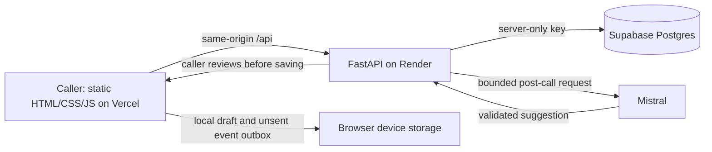

# Caller's Cockpit

A focused workspace for cold calls: context on the left, an eight-stage guide in the centre, and the prospect's words on the right. One free-text box during the call; structured taps and commitment controls do the rest. A separate journal keeps the stage, words, outcome and next step together.

## Submission links

| Deliverable | URL |
|---|---|
| GitHub | https://github.com/KrishnaLasya-98/callers-cockpit |
| Public app | https://callers-cockpit-ui.vercel.app |
| Render health | https://callers-cockpit.onrender.com/health |
| Drive video | Applicant must provide a public-view Google Drive video, at least six minutes long, with camera on |

The live URLs were verified for the previous repair. Version **3.0.0** in this revision adds the redesigned workspace and resilience features; verify `/health.version` and the deployed assets before claiming this revision is live. The applicant's video and WhatsApp message remain their own work.

**LLM:** Mistral `ministral-8b-2512`, using a free La Plateforme key held by Render. Its single job is optional post-call debrief. It checks captured evidence against the draft log and suggests a stage, outcome, summary and next step. The caller decides. A model response can still be wrong.

## What a caller does

1. Select the prospect, read context and recent calls, then start the call.
2. Move through the guide. Taps create stage events; the one text area captures the prospect's own words. Opening and permission include routing, language and callback exits.
3. Pin an agreed action using type, channel, day and time. Unknown details stay unspecified. A document on a named channel is useful even without a callback date.
4. End the call from any stage. The timer pauses, excluding time spent on the debrief. Confirm the reached stage, choose an outcome and optionally request the model's second look.
5. Apply the suggestion or keep the original log, then save. The journal can be searched and filtered, with reached-stage counts and expandable records.

A contact marked **do not call** cannot be started from the UI. The stage strip records evidence rather than assuming every earlier stage was completed.

## Architecture and data flow



There is no browser-side database or LLM key. Vercel rewrites `/api/*` to Render; both root-directory configurations are supplied. `backend/main.py` defines the API contract, `db.py` contains database access, `llm.py` owns the prompt/model call, and `models.py` validates the model response. `frontend/domain.js` contains pure stage, timing and journal logic; `app.js` manages browser state and requests.

| Table | Responsibility |
|---|---|
| `leads` | Contact context, latest outcome, next step and verification flag |
| `calls` | Start time, final reached stage/outcome, duration, prospect words, next step and accepted review metadata |
| `stage_events` | Ordered evidence captured by taps; stage, event text, optional note and timestamp |

Call and event IDs are UUIDs. The browser generates an ID before sending a create request, retains it if a response is lost, and retries using that same ID. Primary-key upserts prevent duplicate rows. Stage advancement uses a conditional update so a late stage-3 response cannot overwrite stage 7. Closing a call updates its record and then synchronizes the lead; these are separate writes. Retrying the same close can recover a partial failure, but this is not a cross-table transaction.

## Reliability and access boundaries

- Draft words, commitment fields and pending taps survive refresh for up to 24 hours on the same device. Confirmed events are reloaded before queued events are retried. A closed server record clears its old local draft.
- The outbox retries explicit event IDs and blocks final save until pending taps are acknowledged. A failed save retains the draft; no optimistic success message is shown.
- The timer pauses at wrap-up. Returning to the call resumes it without counting review time.
- The API validates UUIDs, outcome vocabulary, stage ranges and text lengths. Bodies are capped at 64 KiB. Responses include a request ID; internal errors hide details. API responses use `no-store`.
- In-memory limits protect the free single-worker service: 240 ordinary requests/minute per observed client IP, and 12 model or login requests/minute. Model requests also have a two-request concurrency cap, a 25-second timeout and bounded evidence/output. These limits reset on restart and are not a distributed quota system. Vercel may share upstream IPs.
- Static production headers limit script/connect origins, framing and content sniffing. Browser tokens stay in memory and passwords are cleared after sign-in. Drafts contain call data, so use trusted devices and keep real data out of the public demo.

**Public demo versus private workspace:** default `REQUIRE_AUTH=false` deliberately permits reviewer access with fictional data. This setting is **not suitable for real prospects**. For a private, single shared workspace, set `REQUIRE_AUTH=true` and `ALLOWED_USER_IDS` to approved Supabase Auth user IDs. The API verifies each bearer token with Supabase and checks the allowlist. Missing configuration fails closed. This is not multi-tenant isolation: approved accounts share one workspace.

Before real-data use, create the approved Auth accounts, use a real backend service-role key, review all RLS policies and apply `sql/production-lockdown.sql` to remove the known permissive anon policies. The legacy anon-policy fallback has been retired. The earlier live setup used an anon key; switching keys and policies is a separate, deliberate account operation. Rotate any credentials previously exposed in screenshots before real-data use. The service-role key must never enter frontend files or the video.

## Local setup (PowerShell)

```powershell
python -m venv .venv
.venv/Scripts/python.exe -m pip install -r backend/requirements.txt
Copy-Item backend/.env.example backend/.env
# Fill the file locally. Never commit real keys.
.venv/Scripts/python.exe -m uvicorn main:app --app-dir backend --reload --port 8000
```

In another terminal:

```powershell
python -m http.server 5500 --directory frontend
```

Open http://localhost:5500. A new Supabase project needs `sql/schema.sql`. Its ten original fictional seeds avoid duplicates by company name; existing source-derived demo records are not changed automatically. No schema migration is required for this UI/API revision. The optional RLS lockdown must be reviewed separately.

## API

| Method | Route | Purpose |
|---|---|---|
| GET | `/health` | Version, process and configuration flags; public |
| GET | `/ready` | Configuration and database connectivity; subject to private-mode authentication |
| POST | `/auth/login` | Exchange approved Supabase credentials for a short-lived access token in private mode |
| GET / POST | `/leads` | List prospects / create a fictional demo lead |
| GET / PATCH | `/leads/{id}` | Context and recent history / edit contact metadata |
| GET / POST | `/calls` | Recent closed calls / idempotent start with an optional client UUID |
| GET | `/calls/{id}` | Recover one call and its events |
| GET / POST | `/calls/{id}/events` | Read or idempotently capture a tap |
| PATCH | `/calls/{id}` | Close or retry a close; synchronize the lead |
| POST | `/llm/debrief` | Read-only model suggestion; no automatic database writes |

## Deploy and roll back

Render: Free Python service, root `backend`, build `pip install -r requirements.txt`, start `uvicorn main:app --host 0.0.0.0 --port $PORT`. `render.yaml` sets Python 3.12 and `/health`. Set `SUPABASE_URL`, `SUPABASE_SERVICE_KEY`, `LLM_KEY`, `LLM_MODEL=ministral-8b-2512`, and `FRONTEND_ORIGIN=https://callers-cockpit-ui.vercel.app`. Configure private-mode variables only when accounts and the service key are ready.

Vercel: Framework **Other**, root repository (output `frontend`) or root `frontend` (output `.`). Both configs point `/api/*` to `https://callers-cockpit.onrender.com/$1`. A new Git deployment must use the correct revision; redeploying an old deployment keeps its old source. Promote the verified preview to production. No frontend secret variables are needed.

The app has no runtime npm dependencies or frontend build. Node packages are development-only tests/formatting. If Vercel detects `package.json`, use install override `echo Static frontend` and build override `exit 0` to avoid installing test tools in deployment.

Before promotion, run the checks below. After promotion, check version 3.0.0, static assets, readiness and public proxy. Keep the previous Vercel production deployment and Render deployment available for rollback. This revision uses the existing table contracts, so rolling back code does not require rolling back schema.

## Verification

```powershell
.venv/Scripts/python.exe -m unittest discover -s tests -v
npm ci
npm test
npx playwright install chromium
npm run test:browser
python scripts/check_deployment.py --expect-version 3.0.0
```

Python tests use isolated fake storage/auth/model responses. DOM tests cover failed start/event/save, refresh recovery, review decisions, timing, escaping and private-mode login. Chromium tests use mock API responses, verify desktop/tablet/phone layout and overflow, and exercise save/reload and keyboard focus. They do **not** claim production-database write coverage. A previous synthetic production-write test was blocked by automatic approval review before execution; a deployed rehearsal still needs to confirm persistence.

CI runs these checks on GitHub. Source research is reproducible locally with `python scripts/analyze_transcripts.py --source .private/task-sources/cold-call-transcripts-100`. Source transcripts and detailed notes remain ignored; only aggregate findings and original design implications are published in `docs/transcript-analysis.md`. Older repository history may retain removed excerpts; history has not been rewritten.

For the applicant's walkthrough and end-to-end explanation, see `docs/TASK.md` and `docs/video-script.md`.
